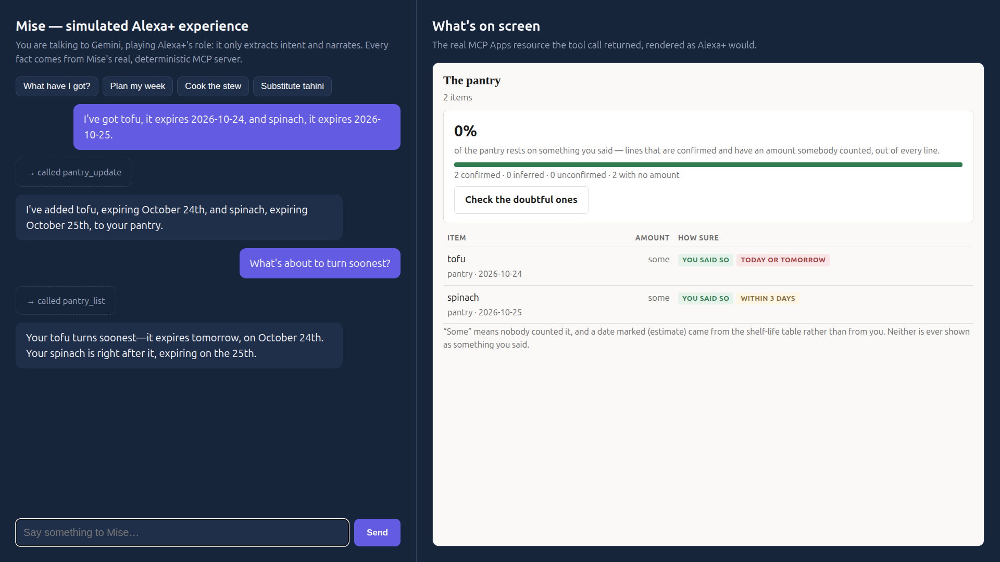
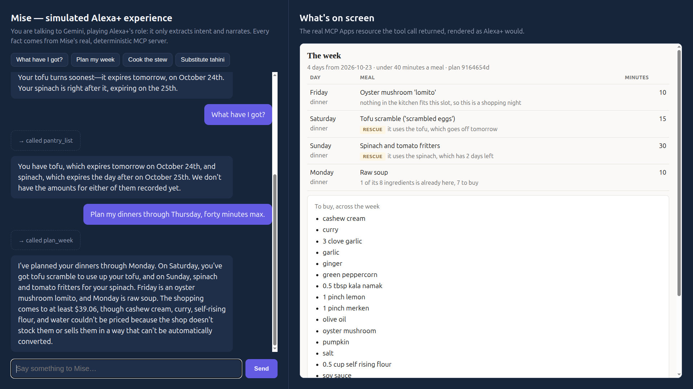
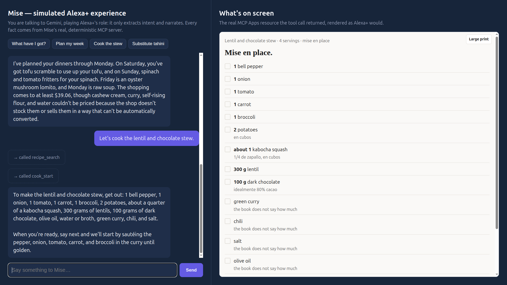
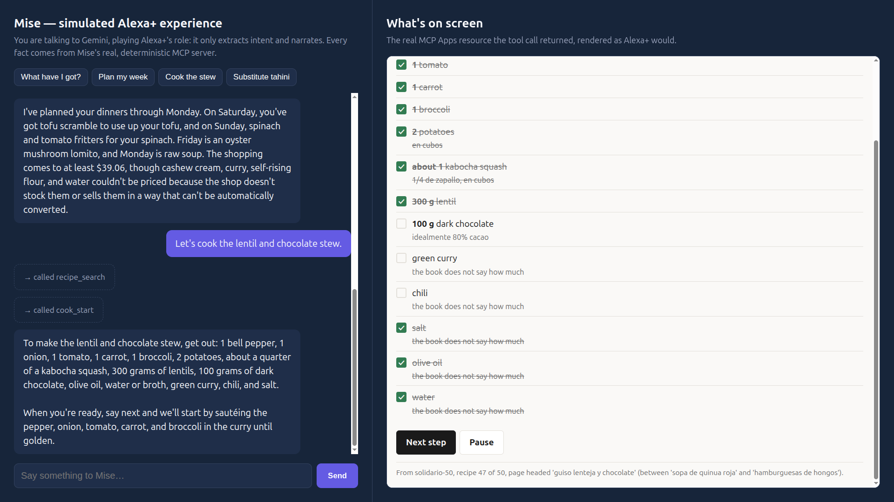
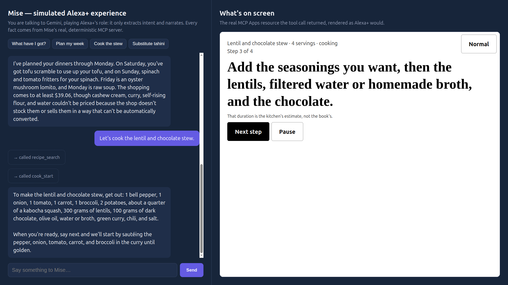
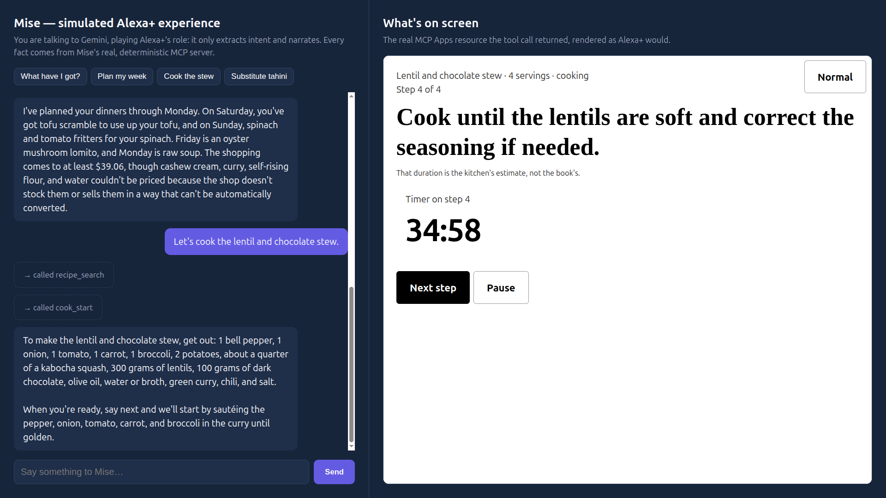
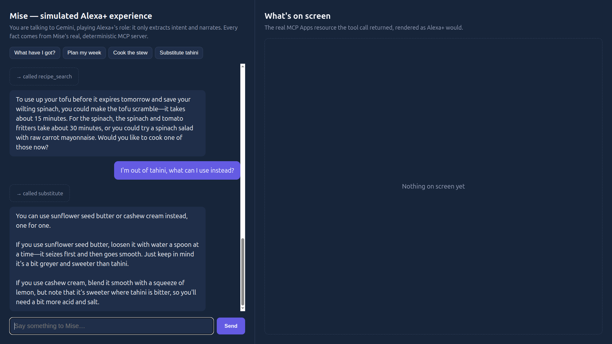

[English](README.md) · [Español](README_ES.md) · **[Technical README](README_TECHNICAL.md)**


# Mise

Keeping track of what is at home, what needs using soon, and where you left off while cooking takes
attention away from dinner. Mise gives Alexa+ a pantry and cooking companion that keeps reported
facts, estimates, and unknowns distinct.

Mise helps plan meals around food already on hand, guide a recipe step by step, and prepare a grocery
cart for what is missing. Its advice comes from curated cooking data and deterministic server logic.

## What it feels like

Ask what is in the pantry, then ask what to cook this week. Mise can explain why a meal was chosen,
including when an ingredient is due to be used. Start cooking and the session remembers its step,
timers, and any changes you reported. If a substitution table has no answer, Mise says so rather than
making one up.

When something is nearing its date, **Zero Waste** looks for recipes already in Mise that use it,
then pairs a match with a short technique lesson. It can also surface a separate tip for scraps that
can regrow. These are ways to make use of what is on hand; Mise does not claim a measured amount of
money saved, waste avoided, or emissions reduced.

The written [demo script](docs/DEMO_SCRIPT.md) shows the intended flow, recorded against
[`simulator/`](simulator/) — a web app that plays Alexa+'s own role (an LLM that narrates, never
decides) over a real MCP connection to this server, the hackathon's own documented alternative to
Alexa+'s region-blocked Web Simulator. The round trip is verified against a real MCP client over
Streamable HTTP — tool listing, guest tools, account-gated rejection, and the four `ui://` views all
confirmed against the running server with live `structuredContent`, reproducible with
`scripts/verify_mcp_roundtrip.mjs` and, for the views specifically, by running `simulator/`. What that
does **not** cover: Alexa+'s own hosted Web Simulator and NLU, which need Alexa+ Preview developer
access this environment does not have. See [what is blocked](docs/BLOCKED.md) for the exact line
between the two.

## Screenshots

All from a real run against the live MCP server, through [`simulator/`](simulator/) — no mockups.

| | |
|---|---|
|  The pantry: what was said, by whom, and how sure Mise is about each line. |  The weekly plan — tofu and spinach get used before they turn, and the plan says why. |
|  Mise en place: a shoppable checklist, not a paragraph read aloud. |  The same checklist mid-cook — real interaction through the MCP Apps bridge, not a static image. |
|  One step, high contrast — the large-print toggle, built for the counter, not the couch. |  A step with its own timer, counting down in real time. |
|  Out of tahini — a real substitution from the chef-curated table, ratio and warning included. | |

## What makes the answers dependable

| When you ask… | Mise responds from… |
|---|---|
| What do I have? | An event history that distinguishes what you confirmed from what the system inferred or has not recently confirmed. |
| What should I cook? | A fixed planner that gives each meal a reason and a repeatable plan hash. |
| What can replace this ingredient? | A chef-curated table with ratios and warnings, or a clear statement that the table has no answer. |
| How nutritious is this recipe? | Curated ingredient values; missing amounts and rows remain visible, so a partial result is stated as a floor. |

Alexa+ handles conversation and chooses tools. The server owns the pantry, planner, cooking state,
curated lookups, and store calculations. A model cannot change those decisions. The technical design,
data contracts, and trust boundaries are in the **[Technical README](README_TECHNICAL.md)**.

## Why this approach

| Alternative considered | Mise's choice |
|---|---|
| Let a model improvise meals, substitutions, or expiry advice. | Use recipes and advice written into curated tables; when the data has no answer, say so. |
| Replace a pantry quantity whenever a new report arrives. | Keep an event history so a person can tell what was stated, inferred, or left unconfirmed. |
| Describe a suggestion as waste or money saved. | Offer existing recipes and scrap-growing tips, without claiming an outcome that was not measured. |

The **[Technical README](README_TECHNICAL.md)** covers other choices, including hosting and account
linking, with the decisions that remain unresolved.

## Try it locally

Requires Node.js 22 or later and Python 3 for the data validators.

```bash
npm install
npm run build
INGEST_SECRET=dev-secret UCP_TOKEN=dev-token npm start
```

The server listens on `http://localhost:8080` by default. Open `/pantry`, `/recipes`, or `/data`, or
check `/healthz`. The demo store is available when `UCP_TOKEN` is set. Run the full local checks with
`npm run check`.

With the server running (its MCP endpoint is `/mcp` on the same port, `8080` unless `PORT` says
otherwise), start the simulated Alexa+ experience (`simulator/`) in a second terminal:

```bash
GEMINI_API_KEY=<your key> MISE_URL=http://localhost:8080/mcp node simulator/server.mjs
```

It listens on `http://localhost:8095` by default (`SIMULATOR_PORT` to change it). Match `MISE_URL`'s
port to whatever the main server actually bound to.

## Project status

Mise is a hackathon build. Local behavior is covered by automated tests and data validators, and the
MCP round trip itself (tool calls, account gating, the four UI resources) is now verified against a
real MCP client over Streamable HTTP, including the MCP Apps host handshake (`simulator/`), where the
real `AppBridge` renders live server data in each view. Alexa+'s own hosted Web Simulator, live AWS
services, real fridge and barcode integrations, and a real UCP client have not been exercised end to
end. See [BLOCKED.md](docs/BLOCKED.md) for the exact status and the evidence needed to change it.

## Where to go next

- [Technical README](README_TECHNICAL.md) — architecture, protocols, data, security, and evidence.
- [Español](README_ES.md) — resumen para personas hispanohablantes.
- [Agent Skills](skills/README.md) — instructions for Alexa+ to use the tools.
- [Ideas and deliberate non-goals](docs/IDEAS.md).

## Repository map

| Area | Purpose |
|---|---|
| `src/` | MCP interface, deterministic domain logic, integrations, and UI resources. |
| `data/` | Versioned recipes, lookup tables, store catalog, and their provenance. |
| `skills/` | Agent Skills that guide tool use without making server decisions. |
| `test/`, `scripts/` | Regression checks, data validators, and curation utilities. |
| `docs/` | Data contracts, technical plans, blocked verification, and demo materials. |

## License

Apache-2.0. See [LICENSE](LICENSE).
