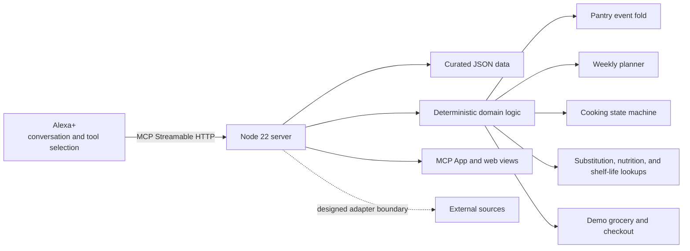

[English](README.md) · [Español](README_ES.md) · **[Technical README](README_TECHNICAL.md)**

# Mise — Technical README

This document is for people auditing or extending Mise. The [English README](README.md) and
[Spanish README](README_ES.md) introduce the product for general readers.

## Scope and current status

Mise is a deterministic MCP server and curated data set for an Alexa+ cooking assistant. Alexa+ is
the only language model in the interaction: it chooses tools, extracts what the person said, and
narrates tool results. The server does not ask a model to rank, match, estimate, or decide.

The local implementation, automated tests, and data validators are present. Several production
integrations remain unverified or are represented by in-memory implementations. In particular,
Alexa+ Web Simulator, AWS services, real source devices, account linking, and a real UCP client have
not been exercised end to end. The [verification ledger](docs/BLOCKED.md) records the status and the
evidence required to change it.

## Architecture



The server exposes MCP tools at `POST /mcp`. HTTP routes also serve recipe pages and JSON-LD,
published data, pantry views, signed ingest, and a demo store. Domain logic and route wiring are in
`src/`; curated tables and recipes are in `data/`.

The repository's deployment plan describes AWS App Runner and DynamoDB. The current stores used by
the server are in-memory (`MemoryPantryStore`, `MemoryCookStore`, `MemoryPlanStore`, cart and checkout
stores). A DynamoDB-backed deployment and its latency have not been verified. See
[the architecture plan](docs/PLAN.md) and [blocked work](docs/BLOCKED.md#b-account-linking-and-state).

## Decision boundary

| Alexa+ | Server |
|---|---|
| Interprets conversational language and extracts tool arguments. | Validates tool arguments at the boundary with Zod. |
| Chooses when to call tools and presents the result conversationally. | Folds pantry events, runs planning and cooking transitions, calculates totals, and performs curated lookups. |
| May ask a person for missing context. | Returns explicit gaps or no-match results; it does not fill them with guesses. |

The deterministic core must remain outside the model. A narrator change must not change a plan, a
substitution match, a pantry quantity, a checkout total, or a cooking transition.

## Data and invariants

Curated tables are versioned data with provenance, not runtime defaults. Code may read those tables
and apply deterministic rules; it must not synthesize a plausible substitution, shelf-life value,
nutrition amount, or technique lesson when a lookup misses. Table contracts are documented in
[`docs/`](docs/RECIPE_SCHEMA.md), including the [substitution](docs/SUBSTITUTION_SCHEMA.md),
[shelf-life](docs/SHELF_LIFE_SCHEMA.md), [nutrition](docs/NUTRITION_SCHEMA.md),
[scaling](docs/SCALING_SCHEMA.md), and [store](docs/STORE_SCHEMA.md) contracts.

| Domain | Stored facts and invariant |
|---|---|
| Pantry | An append-only event log (`add`, `consume`, `correct`, `remove`) is folded into current state. Corrections supersede history through events; records are not edited in place. Confidence travels with each value: `confirmed`, `inferred`, or `stale`. |
| Unknown quantities | Unknown stays `null`, with a known-state flag where totals require it. Missing recipe amounts, unmeasurable units, and absent nutrition rows are returned as named gaps. |
| Expiry | A person's stated date remains distinct from an estimate derived from `data/shelf_life.json`; the estimate is not persisted as a stated date. |
| Recipes | Recipe data preserves source text and labels quantity, duration, and serving certainty. The full contract is in [`docs/RECIPE_SCHEMA.md`](docs/RECIPE_SCHEMA.md). |
| Substitutions | Lookup keys include ingredient, role, and technique. Ratios and warnings come from the table. Unsupported lookups stay unsupported; observed swaps enter a curator queue and are not read back as advice. |
| Nutrition | Values are curated per 100 g and named ingredient state. A total requires complete coverage; otherwise the tool reports a lower bound and the gaps. |
| Money | Catalog prices, tax, and totals use integer cents and basis points. Request-supplied prices are ignored. |
| Plan output | The planner uses fixed ordering and integer scoring. Equal pantry state and constraints produce a repeatable plan and hash. The hash is evidence of identical planner output under those inputs, not a claim about correctness. |

See [`docs/IDEAS.md`](docs/IDEAS.md) for decisions already made and deliberate non-goals.

### Design decisions and rejected alternatives

- **No model inside the server.** Alexa+ already supplies language understanding and tool selection.
  Adding a server model would put consequential choices outside the deterministic code and curated
  tables.
- **No fuzzy ingredient matching.** A near-name match can silently alter a plan or pantry event;
  explicit aliases are curated in `data/source_aliases.json`.
- **No guessed quantities or unit conversions.** Unknown quantities stay `null`; volume-to-weight
  conversion would require a density per ingredient, which is not curated here.
- **No automatic purchasing.** The cart can be prepared, but the checkout requires an explicit
  confirmation for the stated total.
- **No savings or emissions totals.** Suggestions are not evidence that food was consumed or waste
  avoided.

These are product boundaries, not temporary fallbacks. The complete list and the rationale for
deferred ideas are in [`docs/IDEAS.md`](docs/IDEAS.md).

### Alternatives evaluated

| Decision | Alternative | Current choice and status |
|---|---|---|
| Where language reasoning runs | Add another model call inside the server. | Keep Alexa+ as the only model; tool results and curated data remain the authority. |
| Ingredient resolution | Fuzzy string matching. | Resolve through explicit aliases; an unresolved name remains visible instead of becoming a possibly wrong ingredient id. |
| Waste-prevention advice | Generate generic recipes or claim an avoided-waste result. | Rank the existing recipe corpus and report a suggestion, not a measured outcome. |
| Regrowing advice | Treat regrowth as a cooking technique attached to a recipe. | Keep `regrow_tips.json` ingredient-keyed and independent from technique lessons; regrowth describes the scrap, not the dish. |
| Hosting for the planned MCP deployment | Lambda or an always-warm container. | The plan favors App Runner to avoid cold-start and transport uncertainty; the Alexa+ client behavior that would settle Lambda's fit has not been tested. |
| Account linking | Cognito or a small OAuth server. | Still open. First verify Cognito's handling of PKCE, `resource`, and PRM; the fallback is a minimal server. |

The hosting and account-linking decision records are in [`docs/PLAN.md`](docs/PLAN.md) and
[`docs/BLOCKED.md`](docs/BLOCKED.md). The zero-waste content roadmap, including a separate possible
scrap-reuse table, is in [`docs/IDEAS.md`](docs/IDEAS.md).

### Planner scoring and ordering

`planWeek` places existing leftovers first, then handles dated ingredients in increasing urgency and
assigns each the best recipe in the latest still-valid meal slot. It fills remaining slots in day
order. The deadline pass does not silently discard food it cannot place: it returns it in
`unplaceable`.

For each remaining recipe candidate, `scoreRecipe` uses integer points:

```text
score = floor(100 × have / ingredient_count)
      - min(40, 4 × missing_count)
      - 5 × short_count
      + sum(max(20, 100 - 10 × days_to_expiry))  # qualifying unclaimed ingredients only
      + 30 if category fits the meal
      - floor(recipe_minutes / 10)
      - 60 if the primary protein repeats
      - min(60, floor(missing_cost_cents / 100)) # only when a spend ceiling was supplied
```

An ingredient earns urgency points only if it has a nonnegative expiry offset within the planning
window and is still usable on that meal day. The selected recipe is the highest score; ties break by
shorter duration, then recipe id. The fixed ordering and tie-breaks are part of the behavior.

`plan_hash` is SHA-256 over newline-separated canonical fields: start date, day count, meals per day,
time budget, per-day budgets, spending ceiling, sorted avoided ingredient ids, and placed
`day/meal=recipe_id` entries. Pantry quantities and labels that do not change the selected meals are
not directly included. The hash is a stable signature of those planner inputs and placements, not a
cryptographic proof of correctness.

### Lookup and fold order

Substitution lookup tries keys in this order and reports the winning level:

```text
(ingredient, role, technique)
→ (ingredient, role, any technique)
→ (ingredient, any role, any technique)
→ (any ingredient, role, technique)
→ (any ingredient, role, any technique)
```

The table entries are sorted before indexing. A miss is an empty result, not an LLM or fuzzy-match
fallback. See [`src/substitutions.ts`](src/substitutions.ts) and
[`docs/SUBSTITUTION_SCHEMA.md`](docs/SUBSTITUTION_SCHEMA.md).

The pantry fold sorts events by `(timestamp, sequence, external_id, ingredient_id)` before applying
them. Duplicate non-null external ids are skipped. `correct` replaces the line's prior history;
`remove` clears presence; and an `add` after a known zero starts a new batch. If any contributing
quantity is unknown, the folded quantity remains unknown. Shelf-life advice is derived at read time
and never converted into a stated expiry date. See [`src/pantry/fold.ts`](src/pantry/fold.ts).

### Zero-waste ranking

`zeroWaste` excludes pantry lines that are expired, stale, or known to have zero quantity. For each
recipe within the requested time limit it calculates:

- `on_hand`: unique recipe ingredient ids found in the usable pantry;
- `use_first`: the subset whose pantry freshness is `urgent` or `soon`;
- `coverage_percent = floor(100 × on_hand_count / unique_recipe_ingredient_count)`.

Recipes with no pantry match are excluded. Results sort by descending `use_first` count, descending
coverage, ascending recipe minutes, then recipe id. Lessons are included only for techniques present
on matched ingredients and are loaded from the bilingual `data/zero_waste.json` table. Scrap-growing
tips come separately from `data/regrow_tips.json`, keyed to urgent ingredient ids rather than recipe
techniques. The response names uncertain quantities and warns that presence does not guarantee a
sufficient amount. Its economy/ecology notes explicitly say no monetary saving, avoided waste, or
emissions reduction was measured. Implementation: [`src/zero_waste.ts`](src/zero_waste.ts).

## State transitions and concurrency

Cooking is a server-owned state machine. Steps have order, dependencies, and timers; deviations and
transitions are recorded. A second cook receives a track only when the curated recipe dependency
graph permits one. `cook_review` reads the transition log rather than having a model infer what
happened.

Pantry ingest and checkout mutations use idempotency keys with claim, commit, and release stages. A
duplicate in-flight request is refused for retry; a completed key replays only for the same body.
These guarantees are implemented for the in-memory process. Cross-process ordering is not claimed;
multiple instances require a shared persistent store before the guarantee can extend across them.
See [the robustness review](docs/ROBUSTNESS_REVIEW.md#4--concurrency).

## Protocols and surfaces

| Surface | Current behavior |
|---|---|
| MCP | `POST /mcp`, Streamable HTTP; tool results use structured content. Four self-contained `ui://` MCP App resources provide cooking, weekly plan, cart, and pantry views. |
| Recipes | `GET /recipes` and `GET /recipes/:id`; recipe pages carry `schema.org/Recipe` JSON-LD. The importer writes external JSON-LD into `data/imports/` for human review; staging data is not loaded by the server. |
| Curated data | `GET /data` and published table JSON routes expose table versions, provenance, and caveats. |
| Pantry web | `GET /pantry`; `/sim/fridge` is a manual simulation and is not a real connected fridge. |
| Ingest | `POST /ingest/:source` verifies HMAC and idempotency before accepting supported source payloads. The available fridge source is simulated; barcode enrichment has not been verified against a live device or service. |
| UCP-shaped store | `GET /.well-known/ucp` and five checkout endpoints under `/store/checkout-sessions`. The profile carries a disclaimer; wire-level conformance has not been checked against a real client. Details: [`docs/STORE_SCHEMA.md`](docs/STORE_SCHEMA.md). |

The exact route wiring is in [`src/server.ts`](src/server.ts). The import evidence log is
[`docs/IMPORT_SOURCES.md`](docs/IMPORT_SOURCES.md).

Registered tools are `recipe_search`, `pantry_update`, `pantry_list`, `pantry_audit`, `zero_waste`,
`recipe_nutrition`, `substitute`, `plan_week`, `plan_diff`, `cook_start`, `cook_next`,
`cook_where_am_i`, `cook_note`, `cook_checked`, `cook_pause`, `cook_review`, `cook_finish`,
`cart_from_plan`, and `cart_edit`. Account-bound tools return a link-account message while the
single demo identity is not configured.

## Trust and security boundaries

### Threat model

Assume a caller can send arbitrary tool arguments and HTTP requests, replay a captured delivery,
submit misleading prices or product identifiers, and cause a person to rely on an incorrect food
claim. The relevant protected properties are: no silent pantry corruption; no price supplied by a
caller overriding catalog data; no duplicate state-changing delivery; and no table estimate being
spoken as a fact somebody stated. The model does not include compromise of the host, repository, or
curator's source data.

- Tool inputs are untrusted and validated at the server boundary. Curated data is reviewed source
  material, not executable instructions.
- The MCP endpoint is unauthenticated. Before account linking, account-bound demo state is not
  per-user authentication. `DEMO_USER` selects the single demo owner; it does not identify a caller.
- The ingest door is closed when `INGEST_SECRET` is absent. When enabled, it authenticates payloads
  with HMAC and idempotency. The simulated fridge page token is a same-origin defense, not user
  authentication.
- The store is closed when `UCP_TOKEN` is absent. When set, it is a shared bearer secret, not OAuth
  or per-user authorization.
- `/pantry` and `/sim/fridge` are available to anyone who can reach them while the demo account is
  configured. Do not expose a demo deployment with private pantry data.
- The review in [`docs/ROBUSTNESS_REVIEW.md`](docs/ROBUSTNESS_REVIEW.md) states what was probed and
  what remains outside its scope. It is not a blanket security certification.

## Determinism and evidence

Determinism is scoped to pure calculations and the same ordered input facts: pantry fold, curated
lookup, planner result, and their serialized outputs. Event folding has explicit precedence rules so
input order does not change the result. External network calls, persistent multi-instance behavior,
Alexa+ narration, and live checkout are outside that deterministic claim.

There is no published benchmark or measured latency result. The platform plan's 500 ms target is a
design constraint, not a measured outcome for the current in-memory implementation or AWS. Test
coverage demonstrates only the behaviors named by those tests; it does not establish end-to-end
operation with Alexa+ or UCP.

Run local checks:

```bash
npm install
npm run check
```

`npm run check` runs TypeScript typechecking, Node tests, and deterministic data validators. The
validators may report expected coverage gaps, such as ingredients without a demo-store SKU or
nutrition values; read those reports rather than treating a zero exit code as evidence that every
domain value exists.

To start the local server:

```bash
npm run build
INGEST_SECRET=dev-secret UCP_TOKEN=dev-token npm start
```

The process listens on port `8080` unless `PORT` is set. `BASE_URL` controls public recipe identifiers
and same-origin checks. `DEMO_USER` chooses the demo account; an empty value closes account-bound
surfaces. `INGEST_SECRET` enables signed ingest, and `UCP_TOKEN` enables demo checkout. Optional JSON
mirrors are `PANTRY_FILE`, `COOK_FILE`, `PLAN_FILE`, and `CART_FILE`; an unreadable mirror prevents
startup rather than silently starting empty.

For real-target evidence, follow the steps and record the results in [`docs/BLOCKED.md`](docs/BLOCKED.md).

## Failure behavior and limitations

- Missing curated data is returned as missing; there is no general-knowledge substitution or
  estimated fallback.
- Invalid, ambiguous, or unmapped ingest lines are refused or returned with their raw names and
  reasons. They are not silently converted into canonical ingredients.
- A simulated source does not prove a device integration. A UCP-shaped response does not prove
  conformance. A passing test suite does not prove the Alexa+ round trip.
- No monetary saving, emissions reduction, or avoided-waste quantity is computed. A suggestion is
  an opportunity, not evidence that food was used.
- The server cannot wake Alexa+ to deliver a timer or fermentation reminder; long-step guidance is
  returned when the person asks.
- Account linking, persistent multi-instance storage, the Alexa+ simulator, real integrations, and
  real-client UCP behavior remain blocked or unverified as recorded in [`docs/BLOCKED.md`](docs/BLOCKED.md).

## Repository map

| Path | Responsibility |
|---|---|
| `src/server.ts`, `src/tools/` | MCP registration, HTTP routes, input and output contracts. |
| `src/pantry/`, `src/cook/`, `src/plan/`, `src/store/` | Deterministic state and domain logic. |
| `src/integrations/`, `src/ui/` | Source adapters and self-contained MCP App views. |
| `data/` | Curated recipes, tables, catalog, and staging imports. |
| `skills/` | Agent Skills for tool selection and narration. |
| `test/`, `scripts/` | Regression evidence, validators, extractors, and review tools. |
| `docs/` | Contracts, plans, verification ledger, and demo script. |

## Further reading

- [Architecture and implementation plan](docs/PLAN.md)
- [Blocked and unverified work](docs/BLOCKED.md)
- [Robustness review](docs/ROBUSTNESS_REVIEW.md)
- [Recipe schema](docs/RECIPE_SCHEMA.md), [substitution schema](docs/SUBSTITUTION_SCHEMA.md),
  [shelf-life schema](docs/SHELF_LIFE_SCHEMA.md), [nutrition schema](docs/NUTRITION_SCHEMA.md),
  [scaling schema](docs/SCALING_SCHEMA.md), [store schema](docs/STORE_SCHEMA.md)
- [Agent Skills](skills/README.md)
- [License](LICENSE) — Apache-2.0
